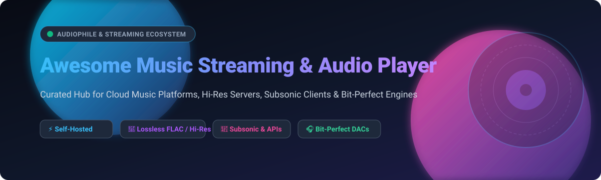

# 🎵 Awesome-Music-Streaming-Audio-Player

  

  
  
  
  
  
  

---

## 🎧 Top Music Streaming & Audio Player Ecosystem

> 🎼 **A curated directory of high-performance SaaS cloud music streaming services, self-hosted media servers, audiophile desktop players, Subsonic clients, and open-source audio engines.**

*Focused on Self-Hosted Music Streaming Servers, Audiophile Desktop/Mobile Players, Subsonic/Jellyfin Clients & Bit-Perfect Audio Engines.*

**Last updated:** November 2026

Welcome to the definitive guide to modern **Music Streaming & Audio Player software**. Whether you are an audiophile looking for bit-perfect FLAC/ALAC playback with dedicated external DACs, a self-hoster seeking sovereign cloud libraries without monthly subscription fees, or an audio software engineer building web audio synthesizers, this list covers the entire landscape from hyperscale cloud streaming to lightweight terminal players.

---

## 📑 Table of Contents
- [📊 Sector Overview & Market Dynamics](#-sector-overview--market-dynamics)
- [☁️ SaaS / Hosted Music Streaming Platforms](#️-saas--hosted-music-streaming-platforms)
- [💻 Open-Source GitHub Projects](#-open-source-github-projects)
- [🛠️ Recommended Architecture Blueprints](#️-recommended-architecture-blueprints)
- [🤝 How to Contribute](#-how-to-contribute)
- [💖 Support](#-support)
- [📜 Disclaimer](#-disclaimer)
- [📈 Star History](#-star-history)

---

## 📊 Sector Overview & Market Dynamics

The global music streaming market is valued at approximately **$38.2 billion in 2024–2025** and is projected to expand beyond **$60 billion by 2030** at an estimated compound annual growth rate (CAGR) of ~14.5%. The cloud streaming segment is **highly concentrated and winner-take-all**, dominated by an oligopoly of tech behemoths (Apple, Alphabet/Google, Amazon) and dedicated music giants (Spotify, Tencent Music) who collectively command over 80% of global paid subscribers due to massive licensing agreements with major record labels (Universal Music Group, Sony Music, Warner Music Group). 

Simultaneously, a thriving counter-movement powered by self-hosting, personal media sovereignty, and open-source audio codecs (FLAC, Opus) has emerged—empowering users to run private music clouds via Subsonic/Jellyfin APIs and stream lossless libraries without subscription lock-in or licensing revocations.

---

## ☁️ SaaS / Hosted Music Streaming Platforms

The table below lists leading commercial music streaming services, sorted descending by **Company Scale (Market Cap / Valuation / Revenue)**.

| 🏢 Platform | 💰 Company Scale (Valuation / Revenue) | 🏷️ Starting Paid Tier | 🎁 Free Tier Limit / Trial Period | 🌟 Key Features & Audio Support |
| :--- | :--- | :--- | :--- | :--- |
| **[Apple Music Web](https://apple.com)** | ~$3.40 Trillion Market Cap (Apple Inc.) | $10.99 / month (Individual) | 30-Day Free Trial (Full catalog access, no free-forever plan) | Lossless ALAC up to 24-bit/192kHz, Spatial Audio (Dolby Atmos), Apple Digital Masters, iCloud matching. |
| **[Amazon Music Web](https://amazon.com)** | ~$2.15 Trillion Market Cap (Amazon.com Inc.) | $9.99 / month (Prime) / $10.99 / month | Ad-supported free tier with top stations & algorithmic playlists (Shuffle mode only, no on-demand skips) | HD & Ultra HD lossless audio (up to 24-bit/192kHz), Dolby Atmos, 360 Reality Audio, Alexa integration. |
| **[YouTube Music](https://youtube.com)** | ~$2.10 Trillion Market Cap (Alphabet Inc.) | $10.99 / month (Music Premium) | Ad-supported free forever tier with ads, screen-on requirement (No background play or offline downloads) | Massive catalog combining official studio tracks with live performances, remixes, covers, and music videos. |
| **[Spotify Web Player](https://spotify.com)** | ~$90 Billion Market Cap (Spotify Technology S.A.) | $11.99 / month (Premium Individual) | Ad-supported free tier with periodic audio ads, shuffle-only on mobile, 160 kbps max bitrate | Algorithmic discovery (Discover Weekly, Daylist), Spotify Connect seamless handoff, collaborative playlists. |
| **[Pandora](https://pandora.com)** | ~$3.8 Billion Market Cap (SiriusXM Holdings) | $4.99 / month (Pandora Plus) | Ad-supported free personalized radio stations with limited skips (6 skips per hour) | Music Genome Project classification, customized acoustic attribute stations, podcast integration. |
| **[Deezer](https://deezer.com)** | ~$450 Million Market Cap (Euronext: DEEZR) | $11.99 / month (Deezer Premium) | Ad-supported free tier limited to shuffle mode, periodic ads, 128 kbps audio (Web & Mobile) | HiFi 16-bit/44.1kHz FLAC streaming, Flow personalized infinite radio, SongCatcher built-in audio recognition. |
| **[SoundCloud](https://soundcloud.com)** | ~$1.0 Billion Valuation (Private) | $4.99 / month (SoundCloud Go) | Free forever tier with ad-supported playback, 120-minute track upload limit for creators | Independent artist uploads, DJ mixes, live sets, audio track stems, interactive waveform timed comments. |
| **[Tidal](https://tidal.com)** | ~$1.2 Billion Valuation (Block Inc. Subsidiary) | $10.99 / month (Tidal Individual) | 30-Day Free Trial (Full HiRes FLAC & Dolby Atmos access, no free-forever tier) | HiRes FLAC (up to 24-bit/192kHz), Dolby Atmos, direct artist payout metrics, stems & DJ software integrations. |
| **[Qobuz](https://qobuz.com)** | ~$120 Million Valuation (Xandrie SA) | $10.83 / month (Studio, billed annually) | 30-Day Free Trial (Full Hi-Res 24-bit access, no free-forever plan) | Hi-Res 24-bit uncompressed audio, downloadable studio digital booklets, dedicated lossless download store. |
| **[Audiomack](https://audiomack.com)** | ~$60 Million Valuation (Private) | $4.99 / month (Audiomack Premium) | Free forever ad-supported plan with unlimited on-demand streaming and offline song downloads | Hip-Hop, Afrobeats, and Electronic discovery platform with direct creator monetization and fan engagement. |

---

## 💻 Open-Source GitHub Projects

The following table lists top open-source media streaming servers, audiophile desktop players, Subsonic clients, and audio engine libraries. Every repository is sorted descending by **GitHub Star Count** and accompanied by a clickable white social star badge linking to its official stargazers page.

| 🚀 Repository | ⭐ Star Badge | 📖 Description |
| :--- | :--- | :--- |
| **[Jellyfin](https://github.com/jellyfin/jellyfin)** |  | The premier volunteer-built free software media server; serves lossless music libraries, smart playlists, lyrics, and metadata to web, desktop, and mobile clients. |
| **[Spotube](https://github.com/team-spotube/spotube)** |  | Lightweight, cross-platform music streaming client combining Spotify playlists and recommendations with YouTube/Piped audio streams without telemetry. |
| **[Howler.js](https://github.com/goldfire/howler.js)** |  | Robust JavaScript audio library for the modern web; defaults to Web Audio API and falls back to HTML5 Audio with multi-channel and 3D sound capabilities. |
| **[Navidrome](https://github.com/navidrome/navidrome)** |  | Blazing fast, self-hosted modern music streaming server written in Go; natively implements the Subsonic/OpenSubsonic API with on-the-fly transcoding and multi-user support. |
| **[Nuclear](https://github.com/nukeop/nuclear)** |  | Modern multi-source desktop music player that aggregates free streaming media from YouTube, Jamendo, SoundCloud, and Audius with Last.fm scrobbling. |
| **[Koel](https://github.com/koel/koel)** |  | Sleek personal audio streaming service written in Vue and Laravel featuring a modern Spotify-like web user interface, smart playlists, and Amazon S3 streaming. |
| **[Beets](https://github.com/beetbox/beets)** |  | The definitive music library manager and tagger; automates metadata collection via MusicBrainz/Discogs, renames files, cleans tags, and transcodes formats. |
| **[Feishin](https://github.com/jeffvli/feishin)** |  | Modern, beautiful cross-platform desktop music player built for Navidrome, Jellyfin, and OpenSubsonic servers with synced lyrics and MPV playback engine. |
| **[ViMusic](https://github.com/vfsfitvnm/ViMusic)** |  | Native Android audio application for streaming YouTube Music tracks with background play, cached playback, synced lyrics, and zero advertising. |
| **[Mopidy](https://github.com/mopidy/mopidy)** |  | Extensible headless music server written in Python; plays music from local disk, Spotify, SoundCloud, and TuneIn via MPD and HTTP extensions. |
| **[cmus](https://github.com/cmus/cmus)** |  | Small, ultra-fast console ncurses audio player for Unix systems; handles libraries with 100k+ songs instantaneously with Vim-style navigation and low memory usage. |
| **[InnerTune](https://github.com/z-huang/InnerTune)** |  | Material 3 YouTube Music client for Android with dynamic theming, offline song caching, background playback, and accountless playlist management. |
| **[Finamp](https://github.com/finamp-app/finamp)** |  | Dedicated open-source mobile music player engineered specifically for Jellyfin servers with offline syncing, gapless playback, and Transcoding support. |
| **[AmplitudeJS](https://github.com/serversideup/amplitudejs)** |  | Dependency-free HTML5 Web Audio library allowing developers to design custom audio players with full playlist, visualization, and live stream control. |
| **[Clementine](https://github.com/clementine-player/Clementine)** |  | Feature-packed multiplatform music player and library organizer inspired by Amarok 1.4; supports cloud storage, dynamic smart playlists, and internet radio. |
| **[AzuraCast](https://github.com/AzuraCast/AzuraCast)** |  | Turnkey web radio management suite; deploys Icecast and SHOUTcast stations with auto-DJ scheduling, web DJ broadcasting, and live listener statistics. |
| **[Strawberry](https://github.com/strawberrymusicplayer/strawberry)** |  | Audiophile music player and collection manager (Clementine fork) featuring bit-perfect ALSA/WASAPI output, advanced tag editing, and DSD playback. |
| **[RiMusic](https://github.com/fast4x/RiMusic)** |  | Multilingual and multiplatform open-source Android music streaming client based on ViMusic with Android Auto, customized visualizers, and offline storage. |
| **[Ampache](https://github.com/ampache/ampache)** |  | Web-based audio/video streaming application and file manager supporting Subsonic, UPnP/DLNA, WebDAV, DAAP, and Plex APIs with on-the-fly transcoding. |
| **[Harmony Music](https://github.com/anandnet/Harmony-Music)** |  | Elegant cross-platform music streaming app built with Flutter and Material You; offers ad-free streaming, local playback, and synced lyrics. |
| **[Tauon Music Box](https://github.com/Taiko2k/Tauon)** |  | Modern desktop music player engineered for seamless playback; supports CUE sheets, ListenBrainz scrobbling, Airsonic/Jellyfin streaming, and Spotify search. |
| **[MPD (Music Player Daemon)](https://github.com/MusicPlayerDaemon/MPD)** |  | High-performance server-side music daemon separating playback from UI control; stream to ALSA, PulseAudio, JACK, or HTTP streams with thousands of frontends. |
| **[Gonic](https://github.com/sentriz/gonic)** |  | Lightweight Subsonic-compatible streaming server written in Go; engineered for minimal CPU/memory footprint, fast tag caching, and podcast downloading. |
| **[Supersonic](https://github.com/supersonic-app/supersonic)** |  | Lightweight, cross-platform native Subsonic/Jellyfin desktop client written in Go with MPV audio backend, gapless playback, and low resource overhead. |
| **[DeaDBeeF](https://github.com/DeaDBeeF-Player/deadbeef)** |  | Ultimate modular audiophile player for Linux and macOS; features custom GTK UI layouts, 18-band graphic equalizer, bit-perfect ALSA, and DSD playback. |
| **[moOde Audio](https://github.com/moode-player/moode)** |  | Audiophile Linux distribution and web interface for Raspberry Pi; transforms SBCs into high-fidelity wireless audio endpoints with CamillaDSP support. |
| **[Audacious](https://github.com/audacious-media-player/audacious)** |  | Fast, lightweight desktop audio player with classic Winamp skin compatibility, high-precision DSP plugins, and drag-and-drop playlist management. |
| **[musike](https://github.com/Ernani1234/musike)** |  | Lightweight multiplatform music player for YouTube Music catalog; supports genre navigation, full albums, and playlists on desktop, mobile, and Docker without accounts. |

---

## 🛠️ Recommended Architecture Blueprints

Combine these top-tier components to design your ideal music streaming and listening setup:

1. **Self-Hosted Cloud Server**: Run **Navidrome** or **Jellyfin** on a home server, NAS, or VPS behind a Cloudflare / Caddy reverse proxy.
2. **Library Tagging & Clean-up**: Process your FLAC/ALAC audio files through **Beets** to fetch correct MusicBrainz IDs and embedded album art.
3. **Desktop Audio Experience**: Connect **Feishin** or **Supersonic** to your Subsonic server for a sleek Spotify-like UI with gapless playback.
4. **Mobile Streaming**: Connect **Finamp** (Jellyfin) or **Symfonium** / **Tempo** (Subsonic) on iOS/Android for offline caching and Android Auto / CarPlay integration.
5. **Bit-Perfect Audiophile Listening**: Use **Strawberry** or **DeaDBeeF** on desktop, or **moOde Audio** / **MPD** on a Raspberry Pi network endpoint connected to an external USB DAC.

---

## 🤝 How to Contribute

We welcome additions, fixes, and updates from the community!

1. 🍴 **Fork the repository** to your personal GitHub account.
2. 🌿 **Create a new branch** (`git checkout -b add-audio-project`).
3. 📝 **Add your project** in the appropriate table, including official links, pricing details, and star counts.
4. 🚀 **Commit your changes** (`git commit -m 'Add new audio player project'`).
5. 📬 **Submit a Pull Request** with a concise description of the software.

---

## 💖 Support

If you found this curated list helpful for discovering audio players and music streaming software, please consider supporting the project:

- ⭐ **Star this repository** on GitHub to help others find it!
- 🍴 **Fork and share** the project with audiophile communities and self-hosters.
- ☕ **Buy me a coffee**: Support ongoing curation and maintenance via the **[GitHub Sponsors Dashboard](https://github.com/sponsors/ishandutta2007)**.

Thank you to all contributors and music enthusiasts! 🎵🎧

---

## 📜 Disclaimer

- This is an independent **community-curated** resource and is not affiliated with or endorsed by any of the listed companies or project teams.
- Third-party client applications that scrape or reverse-engineer commercial streaming APIs may be subject to upstream provider terms of service.
- For maximum reliability and legal compliance, we recommend self-hosting legally owned lossless audio libraries (`FLAC`, `ALAC`, `Opus`, `MP3`) using self-hosted servers such as Navidrome and Jellyfin.

---

## 📈 Star History

